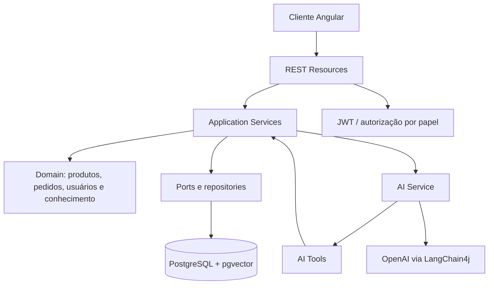

# AI E-Commerce Assistant

Assistente de e-commerce orientado por IA, construído como um monorepo com
backend Quarkus e frontend Angular. O projeto combina catálogo, pedidos,
autenticação, documentos de conhecimento e conversas contextualizadas sem
permitir que o LLM seja a fonte de verdade para preço, estoque, autorização ou
estado do pedido.

## Problema resolvido

Uma operação de e-commerce precisa responder dúvidas e consultar informações de
pedido com linguagem natural, mas as respostas devem continuar vinculadas a
dados confiáveis do domínio. Este projeto separa a conversa assistida por IA
dos casos de uso determinísticos: o assistente consulta serviços da aplicação,
que aplicam autorização, regras de domínio e persistência.

O estado atual inclui:

- login com JWT e senhas protegidas com Argon2;
- catálogo de produtos e consulta de pedidos;
- conversas autenticadas com `conversationId` obrigatório;
- ingestão, processamento, publicação e remoção de documentos de conhecimento;
- recuperação de conhecimento com embeddings e escopo controlado;
- bootstrap operacional do primeiro administrador pela CLI;
- frontend Angular para consumir catálogo, pedidos e chat.

## Arquitetura



As dependências seguem `presentation -> application -> domain`; infraestrutura
implementa persistência, segurança e integração com IA. As ferramentas da IA
não acessam banco diretamente: elas delegam aos casos de uso da aplicação.

## Tecnologias

### Backend

- Java 21 e Quarkus 3.39.3;
- REST, Jackson, Hibernate ORM/Panache e Bean Validation;
- PostgreSQL 16 com extensão pgvector;
- Flyway para migrações versionadas;
- SmallRye JWT e Argon2;
- LangChain4j/OpenAI para chat, memória de conversa e embeddings;
- JUnit 5, Mockito e testes de integração com perfil PostgreSQL.

### Frontend

- Angular 22, TypeScript 6 e RxJS;
- Vitest para testes unitários;
- npm 11.

## Como executar

### Pré-requisitos

- JDK 21;
- Docker Desktop e Docker Compose;
- Node.js compatível com npm 11;
- uma chave da OpenAI somente para executar os fluxos de IA.

### Banco local

Defina as variáveis usadas pelo Compose em um arquivo `.env` na raiz. O arquivo
é local e não deve ser versionado:

```dotenv
POSTGRES_DB=ecommerce
POSTGRES_USER=ecommerce
POSTGRES_PASSWORD=ecommerce
```

Inicie o PostgreSQL com pgvector:

```powershell
docker compose up -d
```

### Backend

Configure `OPENAI_API_KEY` e, se necessário, as variáveis de JWT descritas em
`backend/ai-ecommerce-assistant/application.properties.example`. Depois execute:

```powershell
cd backend/ai-ecommerce-assistant
./mvnw quarkus:dev       # Linux/macOS
./mvnw.cmd quarkus:dev   # Windows
```

As migrações Flyway são aplicadas automaticamente. O backend fica disponível
em `http://localhost:8080`.

O primeiro administrador não é criado por endpoint público. Use a aplicação
Quarkus em modo bootstrap, com entrada interativa no terminal:

```powershell
./mvnw.cmd quarkus:run
```

Para criar também um usuário de teste, passe `-Dquarkus.args="--test-user"`.
O `@QuarkusMain` registrado pela aplicação seleciona o comando
`account-bootstrap`.

### Frontend

```powershell
cd frontend/ai-ecommerce-assistant
npm ci
npm start
```

Abra `http://localhost:4200`. Para uma compilação de produção use `npm run
build`.

## Contratos HTTP principais

| Método | Rota | Finalidade |
| --- | --- | --- |
| `POST` | `/api/auth/login` | autenticar e obter token |
| `GET` | `/api/products` | listar produtos |
| `GET` | `/api/products/{id}` | consultar produto |
| `GET` | `/api/orders/{id}` | consultar pedido autorizado |
| `GET/POST` | `/api/conversations` | listar/criar conversas |
| `POST` | `/api/chat?conversationId={id}` | conversar como usuário autenticado |
| `POST` | `/api/knowledge-documents` | enviar documento como administrador |

O endpoint de chat recebe texto puro e exige `conversationId`; documentos de
conhecimento são protegidos por papel administrativo. A implementação atual é a
fonte do contrato detalhado e dos códigos de erro.

## Testes realizados

Executados em 13 de outubro de 2026:

- `npm test -- --watch=false`: **2 testes aprovados**;
- `npm run build`: **aprovado**;
- `./mvnw.cmd test`: não concluiu porque o teste de persistência tentou acessar
  `localhost:5432` enquanto o PostgreSQL local estava desligado. O erro é de
  ambiente (`Connection refused`), não uma falha de asserção. Inicie o Compose
  antes de repetir o comando.

Backend e frontend também possuem testes de contrato, autorização, domínio,
serviços de aplicação, segurança, persistência e integração. A validação de
produção exige repetir os testes Maven com PostgreSQL disponível.

## Decisões técnicas

- O domínio não depende de REST, JSON, LangChain4j ou detalhes de Panache.
- Recursos REST são finos; regras de negócio pertencem ao domínio e aos
  serviços de aplicação.
- O LLM é tratado como entrada não confiável. Preços, estoque, autorização,
  pagamentos e estados de pedido vêm de dados e regras determinísticas.
- JWT separa autenticação de autorização; a propriedade `role` é mapeada para
  os papéis usados pelas rotas.
- O bootstrap do primeiro administrador é operacional e protegido por lock
  transacional PostgreSQL; não existe provisionamento público equivalente.
- Migrações Flyway são aditivas e o Hibernate valida o schema em vez de
  alterá-lo automaticamente.

## Estrutura

```text
backend/ai-ecommerce-assistant/
  src/main/java/com/victor/ecommerce/
    domain/          regras e conceitos de negócio
    application/     casos de uso e orquestração
    infrastructure/  banco, segurança e IA
    presentation/    REST e CLI
frontend/ai-ecommerce-assistant/
  src/app/           aplicação Angular
specs/               contratos, guardrails e desenvolvimento orientado a specs
docker-compose.yml   PostgreSQL com pgvector
```

## Segurança e configuração

Não versione `.env`, chaves JWT, credenciais, tokens ou chaves da OpenAI. Os
valores de configuração devem vir de variáveis de ambiente ou de arquivos locais
ignorados pelo Git. Antes de abrir uma contribuição, revise `AGENTS.md` e os
documentos em `specs/`.

## Status

O projeto está em desenvolvimento ativo. A base de autenticação, catálogo,
pedidos, chat, conhecimento e bootstrap administrativo está implementada; a
prontidão para produção depende de executar a suíte completa com PostgreSQL,
configurar chaves reais de forma segura e validar os fluxos de negócio ponta a
ponta.
