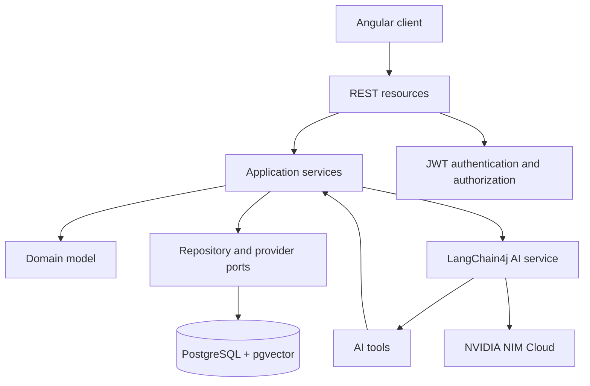

# AI E-Commerce Assistant

AI-assisted e-commerce monorepo built with Quarkus, Angular, PostgreSQL,
pgvector, LangChain4j, and NVIDIA NIM Cloud.

The project demonstrates how to integrate an LLM into a deterministic
application without allowing the model to become the source of truth for
prices, inventory, authorization, payments, or order state.

## Current capabilities

The project provides administrator bootstrap, user registration, Argon2id password
hashing, RSA-signed JWT access tokens, role-based authorization, conversation
ownership, product and order consultation, structured chat responses, scoped
RAG documents, Angular screens, correlation IDs, health endpoints, and local
container definitions.

Refresh tokens, password recovery, checkout, payments, advanced inventory,
promotions, returns, and reports are not implemented and are tracked separately.

## Architecture



The dependency direction is `presentation -> application -> domain`.
Infrastructure implements persistence, security, and AI integration ports.
AI tools delegate to application services instead of accessing the database directly.

## Technology

- Java 21 and Quarkus 3.40.1 LTS;
- REST, Jackson, Hibernate ORM/Panache, Bean Validation, and Flyway;
- PostgreSQL 16 with pgvector;
- SmallRye JWT and Argon2id password hashing;
- LangChain4j with NVIDIA NIM Cloud for chat and the existing embedding provider;
- Angular 22, TypeScript 6, RxJS, Vitest, and npm 11.

## Prerequisites and secrets

- JDK 21;
- Docker Desktop and Docker Compose;
- Node.js compatible with npm 11;
- an NVIDIA API key for live AI flows;
- locally generated RSA keys for JWT signing and verification.

Never commit `.env`, credentials, access tokens, private keys, or API keys.
The repository intentionally does not provide a tracked `.env.example` file.

Chat uses NVIDIA NIM Cloud through LangChain4j's OpenAI-compatible adapter.
This keeps the application code and `/api/chat` contract provider
agnostic. Embeddings remain unchanged because existing pgvector data uses a
1536-dimensional schema; changing embeddings is a separate future migration.

Create an untracked `.env` file at the repository root:

```dotenv
POSTGRES_DB=ecommerce
POSTGRES_USER=ecommerce
POSTGRES_PASSWORD=change-me-locally
```

## Local execution

Start and stop PostgreSQL with:

```powershell
docker compose up -d
docker compose down
```

Run the backend on Windows:

```powershell
cd backend/ai-ecommerce-assistant
./mvnw.cmd quarkus:dev
```

The API is available at `http://localhost:8080`. The first administrator is
created through the protected CLI command, not a public HTTP endpoint:

```powershell
./mvnw.cmd quarkus:run
./mvnw.cmd quarkus:run -Dquarkus.args="--test-user"
```

Run the frontend with:

```powershell
cd frontend/ai-ecommerce-assistant
npm ci
npm start
```

The frontend is available at `http://localhost:4200`.

## Container stack

The `docker-compose.mvp.yml` stack requires external database credentials,
`NVIDIA_API_KEY`, and `JWT_KEYS_DIR`.

```powershell
cd backend/ai-ecommerce-assistant
./mvnw.cmd package -DskipTests
cd ../..
docker compose -f docker-compose.mvp.yml config
docker compose -f docker-compose.mvp.yml up -d
```

The backend health endpoints are `/q/health/live` and `/q/health/ready`.

## Main HTTP contracts

| Method | Route | Purpose |
| --- | --- | --- |
| `POST` | `/api/auth/register` | Register a user with a `USER` role |
| `POST` | `/api/auth/login` | Authenticate and obtain an access token |
| `GET` | `/api/products` | List products |
| `GET` | `/api/products/{id}` | Retrieve a product |
| `GET` | `/api/orders` | List orders owned by the authenticated user |
| `GET` | `/api/orders/{id}` | Retrieve an authorized order |
| `GET/POST` | `/api/conversations` | List or create owned conversations |
| `POST` | `/api/chat?conversationId={id}` | Chat in an owned conversation |
| `POST` | `/api/knowledge-documents` | Upload a document as an administrator |

The detailed contract is maintained in `specs/CONTRACT.md` and the relevant
feature specifications under `.specs/`.

## Validation status

The latest local validation recorded in the repository is:

- frontend `npm run test:ci`: 51 tests passed in 17 files;
- frontend `npm run coverage`: 51 tests passed; baseline coverage is 90.89%
  statements, 92% branches, 75% functions, and 93.18% lines;
- frontend `npm run typecheck` and `npm run format:check`: passed;
- backend `mvnw.cmd -Pfull-validation verify`: 114 tests passed, 0 failed;
- backend JaCoCo baseline from `target/jacoco-report`: 76.16% lines, 52.38%
  branches, and 74.21% instructions;
- browser acceptance and live NVIDIA/RAG validation remain pending in issues
  [#50](https://github.com/Ivictors/ai-ecommerce-assistant/issues/50) and
  [#57](https://github.com/Ivictors/ai-ecommerce-assistant/issues/57);
- the authentication interface is implemented, with manual desktop and mobile
  review pending in issue
  [#58](https://github.com/Ivictors/ai-ecommerce-assistant/issues/58).

The current Maven profile executes database-backed integration tests through
Surefire and intentionally skips Failsafe integration-test execution. Browser
manual acceptance and live AI/RAG quality validation are tracked in issue #50;
test execution separation was implemented in issue #52.

Quality commands:

```powershell
cd backend/ai-ecommerce-assistant
.\mvnw.cmd verify
.\mvnw.cmd -Pfull-validation verify

cd ../../frontend/ai-ecommerce-assistant
npm run test:ci
npm run coverage
npm run typecheck
npm run format:check
```

Coverage is currently reported as a baseline. It is used to identify critical
paths that need stronger tests; no arbitrary global percentage gate is enforced
yet.

Every push to `main` and every pull request targeting `main` runs the GitHub
Actions workflow in `.github/workflows/ci.yml`. It validates Java 21 with the
PostgreSQL/pgvector service, Angular tests and production build, npm audit,
formatting, TypeScript, Docker Compose configuration, and tracked-secret
patterns. Reports are uploaded as workflow artifacts when available. The
workflow does not deploy automatically and uses only CI-local database values;
NVIDIA credentials are not required because the backend tests use provider
placeholders and do not make live model calls.

Run backend tests from `backend/ai-ecommerce-assistant`:

```powershell
# Unit tests; does not require PostgreSQL
.\mvnw.cmd test

# Database-backed integration tests; requires PostgreSQL/pgvector
.\mvnw.cmd -Pintegration-tests test

# All Quarkus tests in the Surefire-based validation profile
.\mvnw.cmd -Pfull-validation verify
```

The default `unit-tests` profile excludes database-backed classes explicitly so
their static test setup cannot open a PostgreSQL connection before JUnit tag
filtering. The `integration-tests` profile includes those classes deliberately.
Failsafe remains reserved for future `@QuarkusIntegrationTest` execution of the
packaged application.

## Engineering workflow

The repository uses a lightweight issue-driven workflow for ongoing work. Each
issue defines its scope and acceptance criteria, changes are
made sequentially on `main`, and each issue receives an individual Conventional
Commit. Existing specifications remain historical project context; new work
does not create additional SLDD artifacts. Do not deploy production from this
workflow.

## Repository structure

```text
backend/ai-ecommerce-assistant/  Quarkus application
frontend/ai-ecommerce-assistant/ Angular application
specs/                           contracts and development process
.specs/                          feature specifications and evidence
docker-compose.yml               PostgreSQL and pgvector
docker-compose.mvp.yml           local three-service container stack
```

## Status

The project is ready for repository-level review and local demonstration.
Official production delivery is not authorized yet. Production hardening, CI quality
gates, browser/live-provider acceptance, refresh-token lifecycle, password
recovery, and transactional commerce remain tracked in GitHub Issues.
