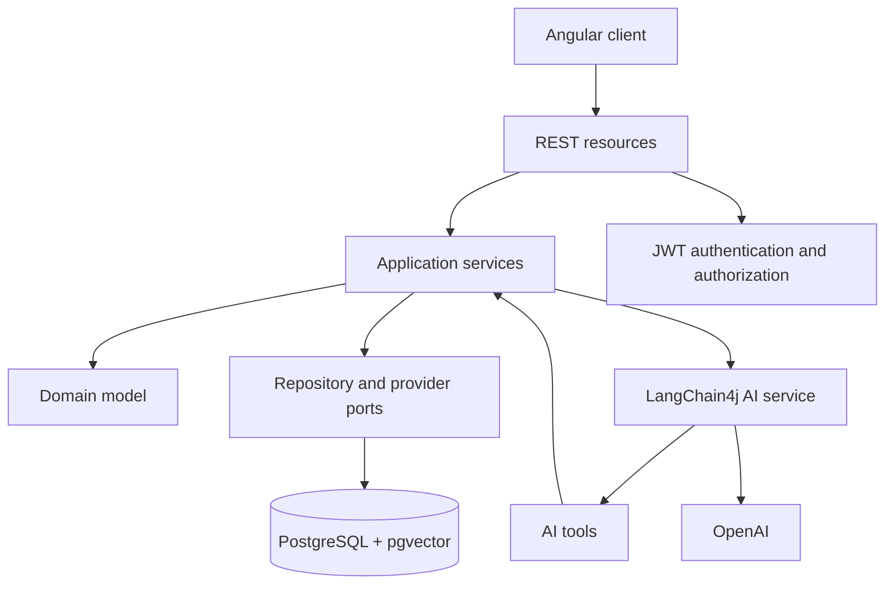

# AI E-Commerce Assistant

AI-assisted e-commerce monorepo built with Quarkus, Angular, PostgreSQL,
pgvector, LangChain4j, and OpenAI.

The project demonstrates how to integrate an LLM into a deterministic
application without allowing the model to become the source of truth for
prices, inventory, authorization, payments, or order state.

## Current MVP

The implemented MVP provides administrator bootstrap, Argon2id password
hashing, RSA-signed JWT access tokens, role-based authorization, conversation
ownership, product and order consultation, structured chat responses, scoped
RAG documents, Angular screens, correlation IDs, health endpoints, and local
container definitions.

Refresh tokens, password recovery, checkout, payments, advanced inventory,
promotions, returns, and reports are outside the MVP and tracked separately.

## Architecture



The dependency direction is `presentation -> application -> domain`.
Infrastructure implements persistence, security, and AI integration ports.
AI tools delegate to application services instead of accessing the database directly.

## Technology

- Java 21 and Quarkus 3.40.1 LTS;
- REST, Jackson, Hibernate ORM/Panache, Bean Validation, and Flyway;
- PostgreSQL 16 with pgvector;
- SmallRye JWT and Argon2id password hashing;
- LangChain4j/OpenAI for chat, memory, and embeddings;
- Angular 22, TypeScript 6, RxJS, Vitest, and npm 11.

## Prerequisites and secrets

- JDK 21;
- Docker Desktop and Docker Compose;
- Node.js compatible with npm 11;
- an OpenAI API key for live AI flows;
- locally generated RSA keys for JWT signing and verification.

Never commit `.env`, credentials, access tokens, private keys, or API keys.
The repository intentionally does not provide a tracked `.env.example` file.

Create an untracked `.env` file at the repository root:

```dotenv
POSTGRES_DB=ecommerce
POSTGRES_USER=ecommerce
POSTGRES_PASSWORD=change-me-locally
```

## Local execution

Start and stop PostgreSQL with:

```powershell
docker compose up -d
docker compose down
```

Run the backend on Windows:

```powershell
cd backend/ai-ecommerce-assistant
./mvnw.cmd quarkus:dev
```

The API is available at `http://localhost:8080`. The first administrator is
created through the protected CLI command, not a public HTTP endpoint:

```powershell
./mvnw.cmd quarkus:run
./mvnw.cmd quarkus:run -Dquarkus.args="--test-user"
```

Run the frontend with:

```powershell
cd frontend/ai-ecommerce-assistant
npm ci
npm start
```

The frontend is available at `http://localhost:4200`.

## MVP container stack

The `docker-compose.mvp.yml` stack requires external database credentials,
`OPENAI_API_KEY`, and `JWT_KEYS_DIR`.

```powershell
cd backend/ai-ecommerce-assistant
./mvnw.cmd package -DskipTests
cd ../..
docker compose -f docker-compose.mvp.yml config
docker compose -f docker-compose.mvp.yml up -d
```

The backend health endpoints are `/q/health/live` and `/q/health/ready`.

## Main HTTP contracts

| Method | Route | Purpose |
| --- | --- | --- |
| `POST` | `/api/auth/login` | Authenticate and obtain an access token |
| `GET` | `/api/products` | List products |
| `GET` | `/api/products/{id}` | Retrieve a product |
| `GET` | `/api/orders` | List orders owned by the authenticated user |
| `GET` | `/api/orders/{id}` | Retrieve an authorized order |
| `GET/POST` | `/api/conversations` | List or create owned conversations |
| `POST` | `/api/chat?conversationId={id}` | Chat in an owned conversation |
| `POST` | `/api/knowledge-documents` | Upload a document as an administrator |

The detailed contract is maintained in `specs/CONTRACT.md` and the relevant
feature specifications under `.specs/`.

## Validation

The latest recorded MVP validation is:

- backend `mvnw.cmd clean verify`: 106 tests passed;
- frontend `npm test -- --watch=false`: 42 tests passed in 16 files;
- frontend `npm run build`: passed;
- full and production-only npm audits: zero vulnerabilities;
- backend and frontend container images: built successfully;
- Docker services: stopped after validation.

The current Maven profile executes database-backed integration tests through
Surefire and intentionally skips Failsafe integration-test execution. Browser
manual acceptance and live OpenAI/RAG quality validation are tracked in issue
#50; test execution separation is tracked in issue #52.

## Engineering workflow

This repository follows Spec Loops Driven Development (SLDD):

```text
requirements -> business rules -> design -> tests -> implementation -> validation
```

Before changing behavior, read `AGENTS.md`, `specs/SPEC_DRIVEN_DEVELOPMENT.md`,
`specs/CONTRACT.md`, `specs/GUARDRAILS.md`, the relevant feature specification,
existing tests, and the current implementation.

All work is performed sequentially on `main`. Use Conventional Commits and keep
each issue in an individual commit. Do not deploy production from this workflow.

## Repository structure

```text
backend/ai-ecommerce-assistant/  Quarkus application
frontend/ai-ecommerce-assistant/ Angular application
specs/                           contracts and development process
.specs/                          feature specifications and evidence
docker-compose.yml               PostgreSQL and pgvector
docker-compose.mvp.yml           local three-service MVP stack
```

## Status

The MVP is ready for repository-level review and local demonstration. Official
production delivery is not authorized yet. Production hardening, CI quality
gates, browser/live-provider acceptance, refresh-token lifecycle, password
recovery, and transactional commerce remain tracked in GitHub Issues.
